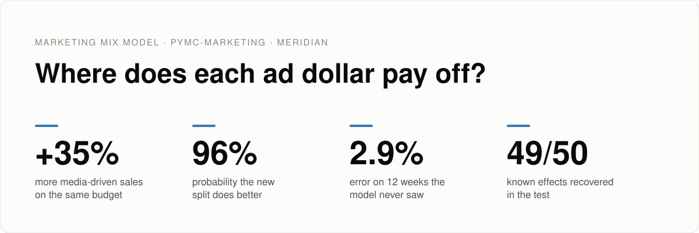
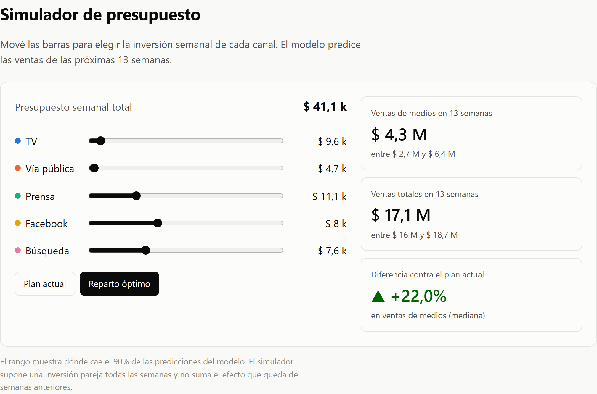
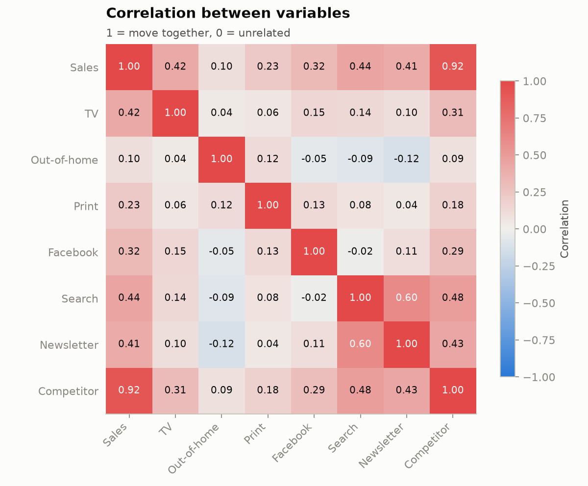
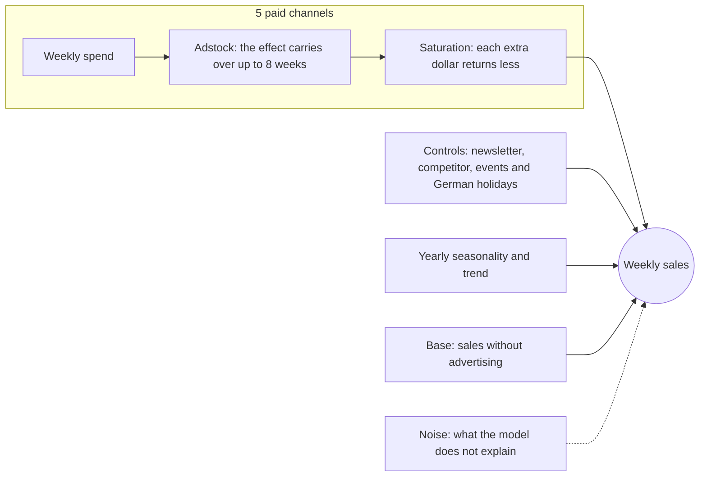
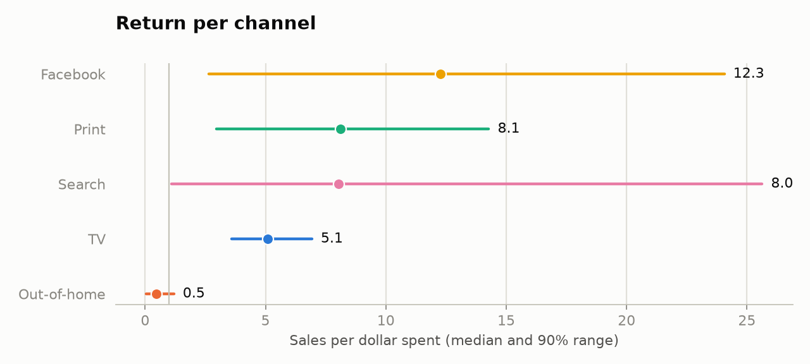
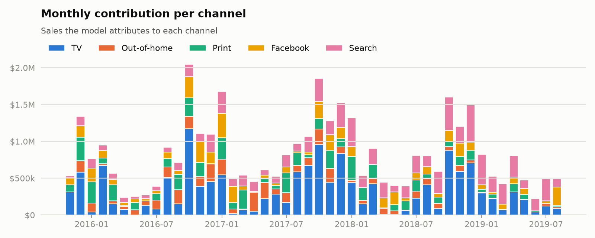
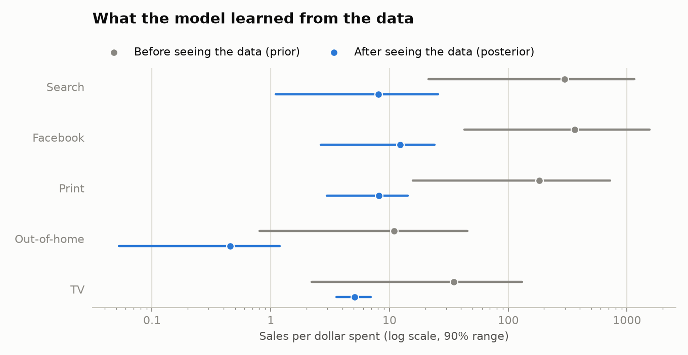
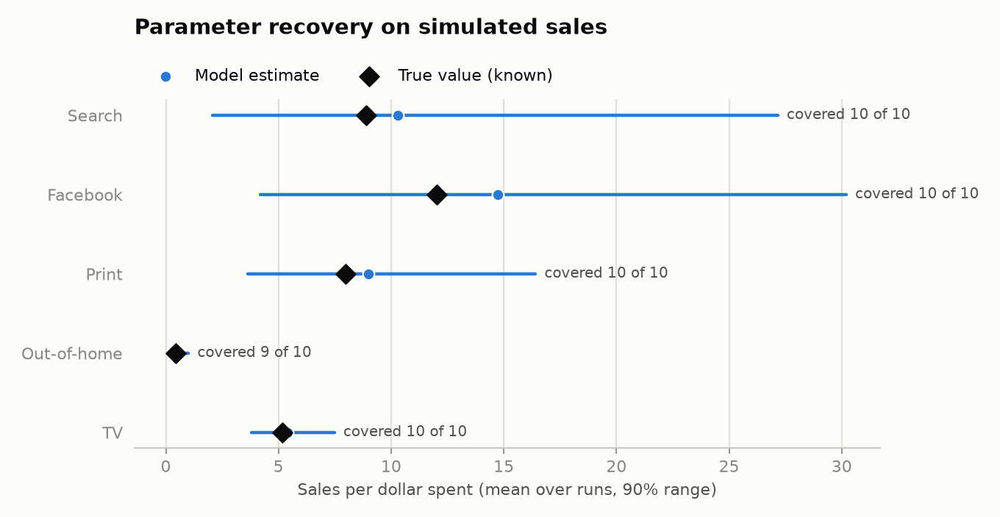
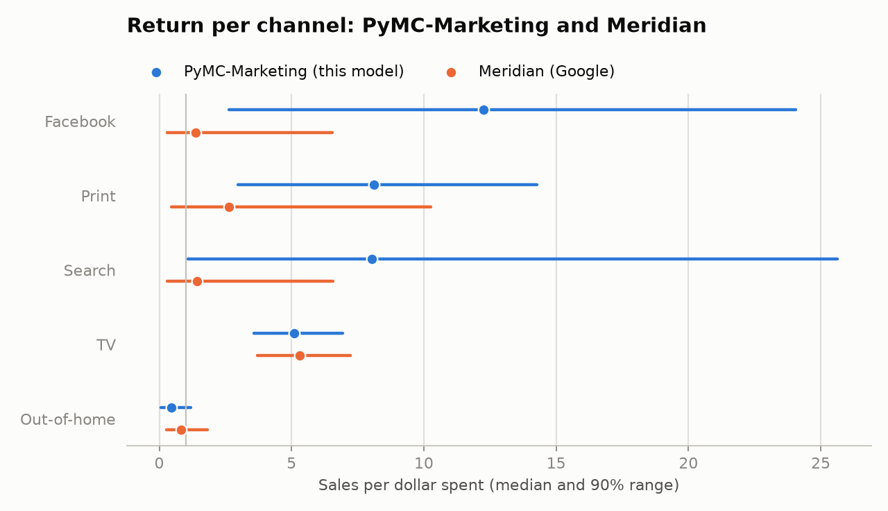
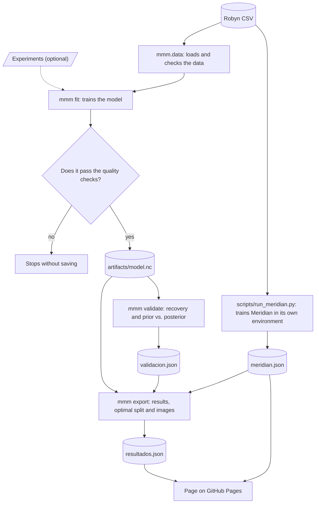

<p align="center">
  <a href="README.md">Español</a> · <b>English</b>
</p>

<picture>
  <source media="(prefers-color-scheme: dark)" srcset="docs/img/en/dark/banner.svg">
  
</picture>

<p align="center">
  <a href="https://hysmarcos.github.io/marketing-mix-model/"></a>
</p>

<p align="center">
  <a href="https://github.com/hysmarcos/marketing-mix-model/actions/workflows/ci.yml"></a>
  
  
  
  
</p>

A company spends on TV, out-of-home, print, Facebook and search. Sales go up and down, but nobody knows how much of them each channel drives. This project answers that question with a statistical model. Then it puts its own answer through five independent tests, to find out how far the answer can be trusted.

> [!NOTE]
> The data is simulated by [Robyn](https://facebookexperimental.github.io/Robyn/), Meta's MMM tool. It is not data from a real company. The live demo page is in Spanish.

## In 30 seconds

The question: how should next quarter's marketing budget be split across channels?

> [!TIP]
> Recommendation: move spend from out-of-home, TV and search to print and Facebook, keeping the same weekly budget. Media-driven sales go up 35% according to the model, and 32% after correcting for the bias the tests measured.

| Conclusion | Confidence | Evidence |
|---|---|---|
| Out-of-home does not pay back its cost | High | Return of 0.5 per dollar. This model and Meridian agree. |
| TV returns about 5 dollars per dollar spent | High | Both models agree. The recovery test finds it almost exactly. |
| The new split sells more than the current one | High | 96% of the model's samples show an improvement. |
| The improvement is about 32% to 35% | Medium | The 90% range goes from +3% to +78%. |
| Print, Facebook and search return more than TV | Medium | The ranges are wide and Meridian gives lower values. |

<a href="https://hysmarcos.github.io/marketing-mix-model/">
  <picture>
    <source media="(prefers-color-scheme: dark)" srcset="docs/img/simulador-dark.png">
    
  </picture>
</a>

<sub>The simulator on the live page: move each channel's spend and see how much the plan sells.</sub>

## What you will find

| If you want to... | Read |
|---|---|
| Understand the business result | [In 30 seconds](#in-30-seconds) and [Results](#4-results) |
| Know whether the result can be trusted | [Can the result be trusted?](#5-can-the-result-be-trusted) |
| See how the model works | [The data](#2-the-data) and [The model](#3-the-model) |
| Run the project | [How it is built](#8-how-it-is-built) and [How to run it](#9-how-to-run-it) |
| Look up a term | [Glossary](#glossary) |

The document follows the order of an analysis: the problem, the data, the model, the results and the tests. Each technical term gets a short definition the first time it appears, and the [glossary](#glossary) links to further reading.

## 1. The problem

Measuring how many sales a channel drives is hard for three reasons:

1. Sales depend on many things at once: the season, holidays, the competition and advertising.
2. The effect of an ad does not end in the week it runs. It carries over for a few more weeks. This effect is called [adstock](#glossary).
3. Each extra dollar in a channel returns less than the one before. This effect is called [saturation](#glossary).

The most direct way to measure a channel is an experiment: switch the channel off in one region and compare. Without experiments, the alternative is a [Marketing Mix Model](#glossary) (MMM). An MMM uses the history of spend and sales to separate each channel's contribution.

## 2. The data

The dataset is Robyn's demo: 208 weeks, starting in November 2015. It has sales, spend on 5 paid channels, a newsletter, special events and a competitor's sales.

Before training a model, it pays to look at how the variables relate. [Correlation](#glossary) measures whether two variables rise and fall together.

<picture>
  <source media="(prefers-color-scheme: dark)" srcset="docs/img/en/dark/correlation.png">
  
</picture>

The chart shows three things that shape the whole analysis:

1. Competitor sales track sales almost exactly (correlation 0.92). Most of the ups and downs in sales do not come from advertising. The model credits media only with what is left after removing this effect.
2. The channels barely move together. The highest [VIF](#glossary) is 1.8 (search), and a VIF above 5 would be a problem. This is why the model can separate each channel's effect.
3. Four channels have no spend in more than half of the weeks. TV has 116 weeks at 0, out-of-home 123, print 121 and Facebook 107. With few weeks of spend, the model has little information, and its ranges are wide.

## 3. The model

The model is [Bayesian](#glossary). It does not give a single number per channel. It gives a range of possible values, each with its probability. This document shows the range that holds 90% of those values.

The diagram shows how the model builds each week's sales:



Each box has parameters that the model estimates from the data. The last 12 weeks are left out of training, to test the model afterwards.

<details>
<summary>Show the model's priors and scaling</summary>

A [prior](#glossary) is what the model assumes about a parameter before seeing the data. The model uses PyMC-Marketing 1.3.0's default priors:

| Parameter | Prior |
|---|---|
| Adstock (`adstock_alpha`) | Beta(1, 3) |
| Saturation, efficiency (`saturation_lam`) | Gamma(3, 1) |
| Saturation, maximum effect (`saturation_beta`) | HalfNormal(2) |
| Base (intercept) | Normal(0, 2) |
| Controls (`gamma_control`) | Normal(0, 2) |
| Seasonality (`gamma_fourier`) | Laplace(0, 1) |
| Noise (`y_sigma`) | HalfNormal(2) |

PyMC-Marketing scales sales and spend before training. The newsletter and competitor sales are scaled in `src/mmm/data.py`, because PyMC-Marketing does not scale controls.

</details>

## 4. Results

A channel's [return](#glossary) (ROI) is how many sales each dollar spent on it drives. To the right of the line at 1, the channel pays back its cost.

<picture>
  <source media="(prefers-color-scheme: dark)" srcset="docs/img/en/dark/roi.png">
  
</picture>

Out-of-home is the only channel that does not pay back its cost: 0.5 per dollar. Facebook has the highest median (12.3), but also the widest range, because it has little spend in the data.

With these returns, the optimal split changes like this:

| Channel | Current weekly spend | Optimal weekly spend | Change |
|---|---:|---:|---:|
| TV | $9,474 | $6,326 | −33% |
| Out-of-home | $9,649 | $0 | −100% |
| Print | $5,938 | $13,753 | +132% |
| Facebook | $3,510 | $12,195 | +247% |
| Search | $12,542 | $8,838 | −30% |
| Total | $41,112 | $41,112 | 0% |

The current plan is the average of the last 13 weeks in the dataset. For the optimal split, scipy's SLSQP algorithm searches for the split with the most media-driven sales in the simulator, at the same weekly total. Each channel can receive up to 1.5 times its highest weekly spend in the data.

Each channel's contribution changes month by month, depending on how much was spent:

<picture>
  <source media="(prefers-color-scheme: dark)" srcset="docs/img/en/dark/contributions.png">
  
</picture>

## 5. Can the result be trusted?

A model can fit the data well and still be wrong. These five tests look for where this model fails:

| | Test | Question | Result |
|:---:|---|---|---|
| ✅ | [Sampler checks](#51-did-the-computation-finish-correctly) | Did the computation finish correctly? | 0 divergences, R-hat 1.002, ESS 1,049 |
| ✅ | [Held-out weeks](#52-does-it-predict-weeks-it-never-saw) | Does it predict weeks it never saw? | 2.9% error over 12 weeks |
| ✅ | [Prior vs. posterior](#53-did-it-learn-from-the-data-or-from-its-assumptions) | Did it learn from the data? | The final range is 1% to 3% of the initial one |
| ⚠️ | [Parameter recovery](#54-does-it-find-effects-we-know) | Does it find known effects? | 49 of 50, but overestimates 3 channels |
| ⚠️ | [Comparison with Meridian](#55-does-another-model-reach-the-same-answer) | Does another model agree? | Yes on 2 channels, no on 3 |

### 5.1 Did the computation finish correctly?

The [sampler](#glossary) is the engine that computes the model. `uv run mmm fit` stops and saves nothing if one of these checks fails:

| Check | Result | Condition |
|---|---:|---|
| Sampler [divergences](#glossary) | 0 | must be 0 |
| Maximum [R-hat](#glossary) | 1.002 | below 1.01 |
| Minimum [ESS](#glossary) | 1,049 | above 400 |

These checks say the computation is stable. They do not say the model is right.

### 5.2 Does it predict weeks it never saw?

The model predicted the last 12 weeks without seeing them during training. The mean error ([MAPE](#glossary)) was 2.9%. A low error says the model explains total sales well. It does not say the model splits sales correctly across channels.

### 5.3 Did it learn from the data or from its assumptions?

If the result after seeing the data (posterior) looks like what the model assumed before (prior), the result comes from the assumptions, not from the data.

<picture>
  <source media="(prefers-color-scheme: dark)" srcset="docs/img/en/dark/prior_posterior.png">
  
</picture>

For all five channels, the final range covers 1% to 3% of the initial range. The result comes from the data.

The chart also shows a flaw in the default priors: before seeing the data, they allow returns of up to 1,500 dollars per dollar spent. No real channel returns that. The data corrected these values, but a more realistic prior would make the model more stable.

### 5.4 Does it find effects we know?

This test is called [parameter recovery](#glossary). It works like this:

1. Take the parameters the model estimated and treat them as the truth.
2. With that truth and the real spend, simulate 10 sales histories, each with different noise.
3. Train a new model on each history and compare what it finds with the truth.

<picture>
  <source media="(prefers-color-scheme: dark)" srcset="docs/img/en/dark/recovery.png">
  
</picture>

The 90% range contained the true value in 49 of 50 cases. But for channels with little spend, the model tends to overestimate the return: Facebook by 23%, search by 16% and print by 13%. TV and out-of-home come out almost exact.

After correcting for that bias, the optimal split improves media-driven sales by 32% instead of 35%. The recommendation does not change, because the bias affects the current plan and the optimal one at the same time.

### 5.5 Does another model reach the same answer?

[Meridian](#glossary) is Google's MMM. I trained it on the same data, the same controls and the same 12 held-out weeks, with its default priors.

<picture>
  <source media="(prefers-color-scheme: dark)" srcset="docs/img/en/dark/meridian.png">
  
</picture>

| Check | PyMC-Marketing | Meridian |
|---|---:|---:|
| Maximum R-hat | 1.002 | 1.008 |
| Error over the 12 held-out weeks (MAPE) | 2.9% | 3.0% |

Both models predict the held-out weeks equally well, and they agree on TV and out-of-home. For print, Facebook and search, Meridian gives lower returns. Its prior on the return pulls values towards 1.2, and those channels carry little information in the data. The ranges of the two models overlap.

### What I conclude from the tests

> [!IMPORTANT]
> Cutting out-of-home spend and keeping TV close to its current level are firm decisions. All five tests support them.

> [!WARNING]
> The size of the gain in print, Facebook and search is uncertain. An [incrementality experiment](#glossary) on those three channels would settle it. The model already accepts those results (see [Calibration with experiments](#7-calibration-with-experiments)).

Two limits remain that no test solves. The data is simulated, so there is no business truth to compare against. Also, the competitor explains a large part of sales. If something affects both the competitor and advertising, the model cannot separate it. This problem is called [confounding](#glossary).

## 6. The simulator

The page's simulator runs in the browser, with no server. It uses 200 model samples exported to `site/data/resultados.json`. It assumes the same spend every week of the quarter. It starts from the real spend of the last 7 weeks, because the effect of that spend carries over for a few more weeks.

The computation exists twice: in Python (`src/mmm/export.py`) and in JavaScript (`site/js/simulator.js`). A test compares both results on 4 cases and requires a relative difference below 1e-6. Another test checks the adstock against PyMC-Marketing's own function.

## 7. Calibration with experiments

An incrementality experiment (lift test) measures how many extra sales a change in a channel's spend drives. When experiments exist, the model uses them to adjust its saturation curves.

To calibrate the model:

1. Copy `data/lift_tests_plantilla.csv` and add one row per experiment.
2. Train the model with `uv run mmm fit --lift-tests <your file>.csv`.

If a row has an error, `mmm fit` stops before training and names the row and the column.

<details>
<summary>Show the columns of the experiments file</summary>

All columns are in dollars per week:

| Column | Meaning |
|---|---|
| `channel` | Experiment channel, for example `facebook_S` |
| `x` | Weekly spend before the experiment |
| `delta_x` | Change in weekly spend during the experiment |
| `delta_y` | Extra weekly sales measured by the experiment |
| `sigma` | Standard error of `delta_y` |

</details>

The published model is not calibrated, because there are no real experiments for this data. Robyn's demo ships example experiments, but their amounts do not match the dataset. For example, the Facebook experiment states $421,000 of spend in weeks where the dataset records $14,049. Calibrating with those values would make the model worse.

## 8. How it is built

The diagram shows the path of the data, from the CSV to the page:



| Folder | Contents |
|---|---|
| `src/mmm/` | Data loading, model, checks, export, validation and charts |
| `notebooks/` | Exploration, model and results, with saved outputs (in Spanish) |
| `site/` | Static page and JavaScript simulator |
| `tests/` | Python tests and cases shared with JavaScript |
| `scripts/` | Meridian comparison and simulator screenshot |
| `data/` | Robyn dataset and experiments template |

On every push, GitHub Actions runs `ruff`, the Python tests and the JavaScript tests. If everything passes on `main`, it publishes the page.

## 9. How to run it

You need `uv` and Node 24. From the repository folder, install the dependencies, train the model and export the results:

```bash
uv sync
```

```bash
uv run mmm fit
```

```bash
uv run mmm export
```

Open the page at `http://localhost:8000`:

```bash
uv run python -m http.server -d site 8000
```

<details>
<summary>Show the validation tests, Meridian and the test suite</summary>

Run the validation tests. They take about 3 minutes:

```bash
uv run mmm validate --runs 10
```

Train Meridian. It runs in its own environment, because it needs a different ArviZ version, and it requires Python 3.13 or earlier:

```bash
uv run --script scripts/run_meridian.py
```

After both, run `uv run mmm export` again to refresh the README images.

Run the Python and JavaScript tests:

```bash
uv run pytest
```

```bash
node --test "site/js/*.test.js"
```

</details>

## Glossary

| Term | Meaning | Further reading |
|---|---|---|
| Adstock | The effect of advertising that carries over into the following weeks. | [Wikipedia](https://en.wikipedia.org/wiki/Advertising_adstock) |
| Bayesian | A method that combines prior assumptions with data and gives ranges with their probability. | [Wikipedia](https://en.wikipedia.org/wiki/Bayesian_inference) |
| Confounding | A third variable that moves both the cause and the effect, and misleads the model. | [Wikipedia](https://en.wikipedia.org/wiki/Confounding) |
| Correlation | A measure from -1 to 1 of how much two variables rise and fall together. | [Wikipedia](https://en.wikipedia.org/wiki/Pearson_correlation_coefficient) |
| Divergences | Steps where the sampler could not compute correctly. They must be 0. | [Stan](https://mc-stan.org/learn-stan/diagnostics-warnings.html) |
| ESS | Effective number of independent samples the sampler produced. | [ArviZ](https://python.arviz.org/en/stable/api/generated/arviz.ess.html) |
| Incrementality experiment | A test that changes a channel's spend and measures the extra sales. | [PyMC-Marketing](https://www.pymc-marketing.io/en/stable/notebooks/mmm/mmm_lift_test.html) |
| MAPE | Mean percentage error between actual and predicted values. | [Wikipedia](https://en.wikipedia.org/wiki/Mean_absolute_percentage_error) |
| Marketing Mix Model | A model that estimates how many sales each marketing channel drives. | [Wikipedia](https://en.wikipedia.org/wiki/Marketing_mix_modeling), [PyMC-Marketing](https://www.pymc-marketing.io/en/stable/guide/mmm/mmm_intro.html) |
| Meridian | Google's open-source Bayesian MMM. | [Google](https://developers.google.com/meridian) |
| Prior and posterior | What the model assumes before seeing the data, and what it concludes after. | [Wikipedia](https://en.wikipedia.org/wiki/Prior_probability) |
| R-hat | Measures whether the sampler's chains reached the same result. It must be close to 1. | [ArviZ](https://python.arviz.org/en/stable/api/generated/arviz.rhat.html), [Stan](https://mc-stan.org/docs/reference-manual/analysis.html) |
| Parameter recovery | A test on simulated data with a known effect, to see whether the model finds that effect. | [Talts et al., 2018](https://arxiv.org/abs/1804.06788), [Recast](https://getrecast.com/why-is-validation-challenging-in-mmm/) |
| Return (ROI) | Sales driven by each dollar spent. | [Wikipedia](https://en.wikipedia.org/wiki/Return_on_investment) |
| Sampler | The algorithm that computes the model by drawing random samples (MCMC). This project uses nutpie. | [Wikipedia](https://en.wikipedia.org/wiki/Markov_chain_Monte_Carlo), [nutpie](https://github.com/pymc-devs/nutpie) |
| Saturation | Each extra dollar in a channel returns less than the one before. | [Wikipedia](https://en.wikipedia.org/wiki/Diminishing_returns) |
| Held-out weeks | Data the model does not see during training, used to test it. | [Wikipedia](https://en.wikipedia.org/wiki/Training,_validation,_and_test_data_sets) |
| VIF | Measures how much a variable overlaps with the others. Above 5 signals a problem. | [Wikipedia](https://en.wikipedia.org/wiki/Variance_inflation_factor), [multicollinearity](https://en.wikipedia.org/wiki/Multicollinearity) |

## Data source and license

The dataset is the `dt_simulated_weekly` demo from [Robyn](https://facebookexperimental.github.io/Robyn/), under the MIT license. `data/raw/FUENTE.md` records the source commit.

The code in this repository is under the MIT license.
