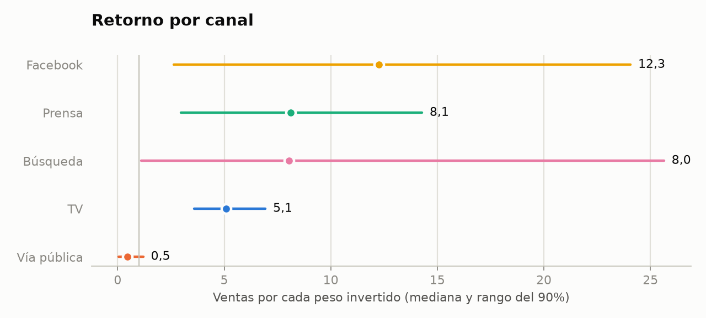
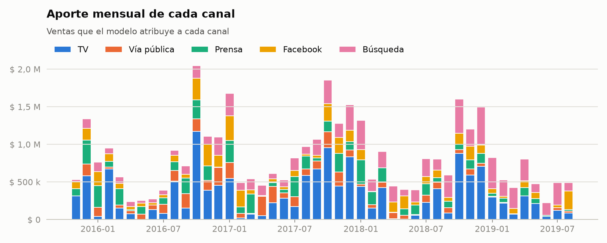

# Marketing Mix Model con PyMC-Marketing

[](https://github.com/hysmarcos/marketing-mix-model/actions/workflows/ci.yml)

> In English: A Bayesian Marketing Mix Model built with PyMC-Marketing on Meta's Robyn demo dataset (208 weeks, 5 paid channels). It estimates the sales each channel drives, passes strict convergence checks and predicts 12 held-out weeks with a 2.9% error. A static page with an in-browser budget simulator shows that the same weekly budget, reallocated, drives about 36% more media sales.

## La pregunta

¿Cómo reparto el presupuesto de marketing del próximo trimestre entre los canales?

La respuesta corta: pasar inversión de vía pública, TV y búsqueda a prensa y Facebook. Con el mismo presupuesto semanal, las ventas que generan los medios suben un 36% según el modelo.

Página con los resultados y el simulador: https://hysmarcos.github.io/marketing-mix-model/

Los datos son simulados por Robyn, la herramienta de MMM de Meta. No son datos de una empresa real.

[](https://hysmarcos.github.io/marketing-mix-model/)

## Resultados

Un Marketing Mix Model (MMM) estima cuántas ventas genera cada canal por cada peso invertido. El retorno por canal es la cantidad de ventas que vuelve por cada peso. A la derecha de la línea en 1, el canal recupera lo invertido.



Vía pública es el único canal que no recupera lo invertido (0,5 por cada peso). Facebook tiene el retorno más alto (12,3), pero con un rango amplio, porque tiene poca inversión en los datos.

| Canal | Inversión semanal actual | Inversión semanal óptima |
|---|---:|---:|
| TV | $ 9.474 | $ 5.267 |
| Vía pública | $ 9.649 | $ 0 |
| Prensa | $ 5.938 | $ 13.898 |
| Facebook | $ 3.510 | $ 12.350 |
| Búsqueda | $ 12.542 | $ 9.597 |
| Total | $ 41.112 | $ 41.112 |

El plan actual es el promedio de las últimas 13 semanas del dataset. Para el reparto óptimo, el algoritmo SLSQP de scipy busca el reparto con más ventas de medios en el simulador, con el mismo total semanal. Cada canal puede recibir hasta 1,5 veces su inversión semanal más alta en los datos.



## Cómo funciona el modelo

El modelo es bayesiano. No da un solo número por canal. Da un rango de valores posibles, cada uno con su probabilidad. La página muestra el rango donde cae el 90% de esos valores.

El modelo tiene estas partes:

1. Inversión semanal de 5 canales pagos: TV, vía pública, prensa, Facebook y búsqueda.
2. Adstock geométrico. El adstock modela que el efecto de un aviso sigue hasta 8 semanas después.
3. Saturación logística. La saturación modela que cada peso extra en un canal rinde menos que el anterior.
4. Controles: newsletter, ventas de la competencia, dos eventos especiales, feriados de Alemania y tendencia. El demo de Robyn usa feriados de Alemania.
5. Estacionalidad anual con 2 pares de ondas de Fourier (ondas que repiten un ciclo por año).

Un prior es lo que el modelo supone antes de ver los datos. El modelo usa los priors por defecto de PyMC-Marketing 1.3.0:

| Parámetro | Prior |
|---|---|
| Adstock (`adstock_alpha`) | Beta(1, 3) |
| Saturación, eficiencia (`saturation_lam`) | Gamma(3, 1) |
| Saturación, efecto máximo (`saturation_beta`) | HalfNormal(2) |
| Intercepto | Normal(0, 2) |
| Controles (`gamma_control`) | Normal(0, 2) |
| Estacionalidad (`gamma_fourier`) | Laplace(0, 1) |
| Ruido (`y_sigma`) | HalfNormal(2) |

PyMC-Marketing escala las ventas y la inversión antes de entrenar. La newsletter y las ventas de la competencia se escalan en `src/mmm/data.py`, porque PyMC-Marketing no escala los controles.

### Controles de calidad

Las últimas 12 semanas quedaron fuera del entrenamiento. El modelo las predijo sin verlas. `uv run mmm fit` se detiene y no guarda nada si falla uno de los tres primeros controles.

| Control | Resultado | Condición |
|---|---:|---|
| Divergencias del sampler | 0 | debe ser 0 |
| R-hat máximo | 1,002 | menor que 1,01 |
| ESS mínimo | 1.049 | mayor que 400 |
| Error en las 12 semanas de prueba (MAPE) | 2,9% | solo informativo |

El sampler es el motor que calcula el modelo. El R-hat mide si sus 4 cadenas llegaron al mismo resultado. El ESS es la cantidad efectiva de muestras independientes. El MAPE es el error porcentual promedio.

### El simulador

El simulador de la página corre en el navegador, sin servidor. Usa 200 muestras del modelo exportadas en `site/data/resultados.json`. Supone una inversión pareja todas las semanas y no suma el efecto que queda de semanas anteriores.

El cálculo existe dos veces: en Python (`src/mmm/export.py`) y en JavaScript (`site/js/simulator.js`). Un test compara los dos resultados en 4 casos y exige una diferencia relativa menor que 1e-6.

## Cómo ejecutar el proyecto

Necesitás `uv` y Node 24. Desde la carpeta del repositorio, instalá las dependencias:

```bash
uv sync
```

Entrená el modelo. Tarda unos minutos y guarda el resultado en `artifacts/`:

```bash
uv run mmm fit
```

Exportá los resultados para la página, los casos de test y las imágenes del README:

```bash
uv run mmm export
```

Corré los tests de Python y de JavaScript:

```bash
uv run pytest
```

```bash
node --test "site/js/*.test.js"
```

Abrí la página en `http://localhost:8000`:

```bash
uv run python -m http.server -d site 8000
```

Los notebooks de `notebooks/` muestran la exploración de los datos, el modelo y los resultados. GitHub los muestra con los resultados guardados.

## Estructura

```
src/mmm/      carga de datos, modelo, controles de calidad, exportación y gráficos
notebooks/    exploración, modelo y resultados
site/         página estática y simulador en JavaScript
tests/        tests de Python y casos compartidos con JavaScript
data/raw/     dataset de demo de Robyn
```

## Próximos pasos

1. Comparar los resultados con Meridian, el MMM de Google.
2. Calibrar el modelo con experimentos de incrementalidad (lift tests).
3. Sumar al simulador el efecto que queda de las semanas anteriores y usar el optimizador de presupuesto de PyMC-Marketing, que tiene en cuenta ese efecto.

## Fuente de los datos y licencia

El dataset es el demo `dt_simulated_weekly` de [Robyn](https://github.com/facebookexperimental/Robyn), con licencia MIT. `data/raw/FUENTE.md` registra el commit de origen.

El código de este repositorio tiene licencia MIT.
