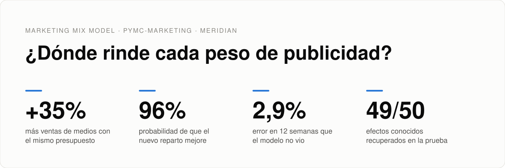
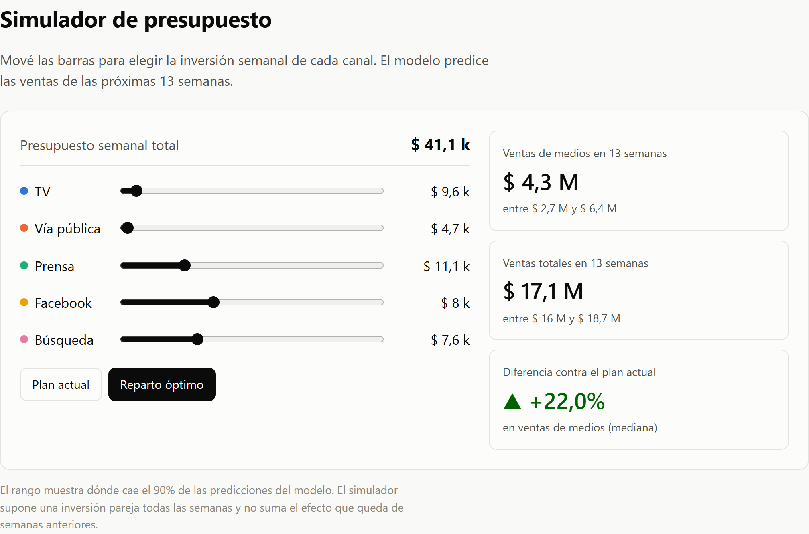
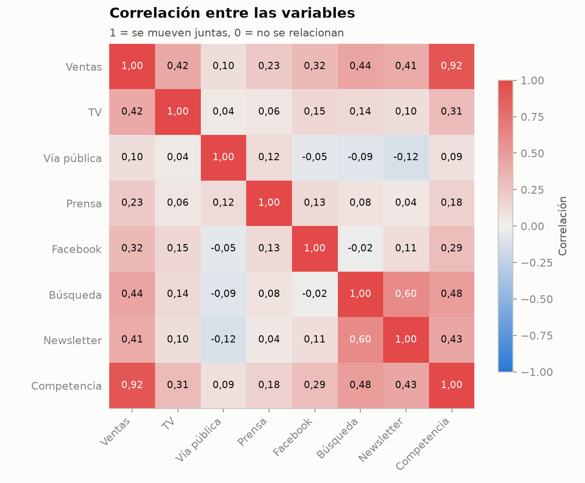
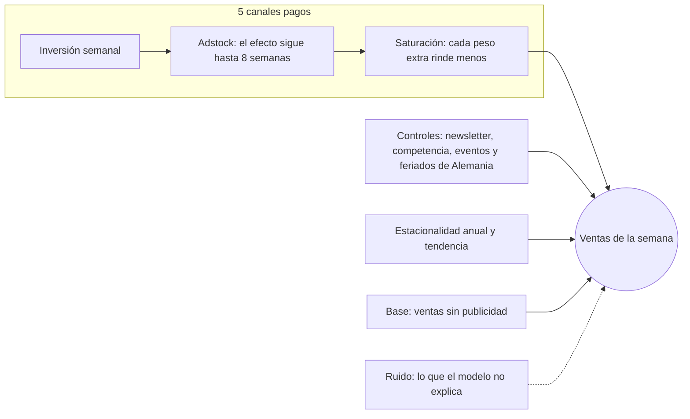
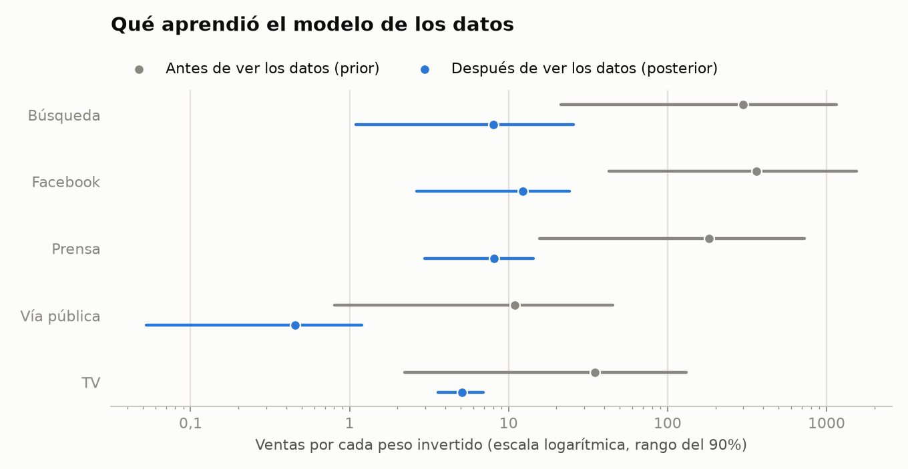
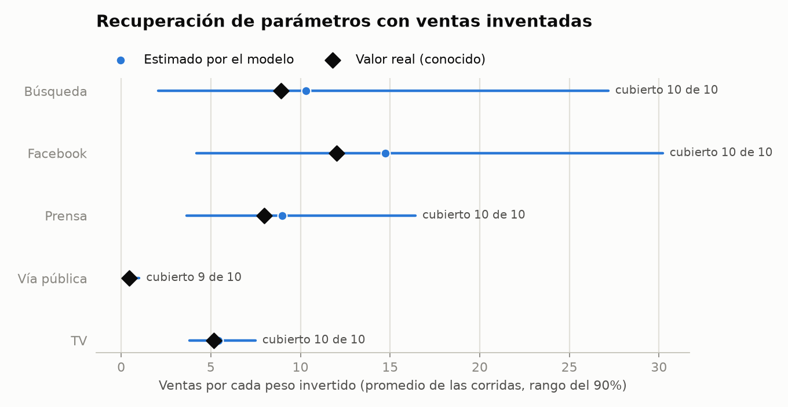
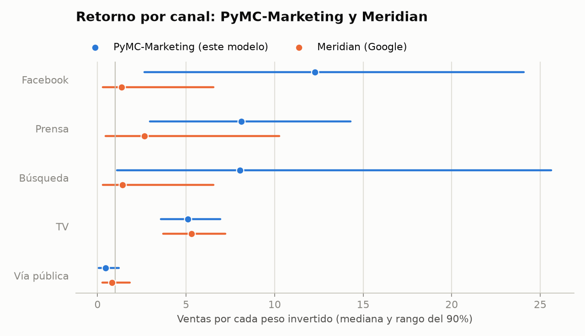
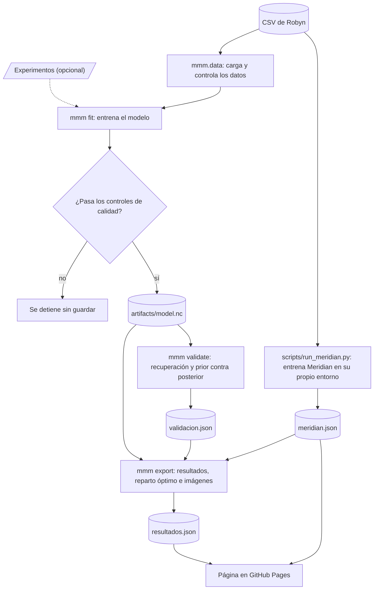

<p align="center">
  <b>Español</b> · <a href="README.en.md">English</a>
</p>

<picture>
  <source media="(prefers-color-scheme: dark)" srcset="docs/img/es/dark/banner.svg">
  
</picture>

<p align="center">
  <a href="https://hysmarcos.github.io/marketing-mix-model/"></a>
</p>

<p align="center">
  <a href="https://github.com/hysmarcos/marketing-mix-model/actions/workflows/ci.yml"></a>
  
  
  
  
</p>

Una empresa invierte en TV, vía pública, prensa, Facebook y búsqueda. Las ventas suben y bajan, pero nadie sabe qué parte de las ventas genera cada canal. Este proyecto responde esa pregunta con un modelo estadístico. Después pone a prueba su propia respuesta con cinco pruebas independientes, para saber cuánto se puede confiar en ella.

> [!NOTE]
> Los datos son simulados por [Robyn](https://facebookexperimental.github.io/Robyn/), la herramienta de MMM de Meta. No son datos de una empresa real.

## En 30 segundos

La pregunta: ¿cómo reparto el presupuesto de marketing del próximo trimestre entre los canales?

> [!TIP]
> Recomendación: pasar inversión de vía pública, TV y búsqueda a prensa y Facebook, con el mismo presupuesto semanal. Las ventas generadas por los medios suben un 35% según el modelo, y un 32% si se corrige el sesgo que midieron las pruebas.

| Conclusión | Confianza | Evidencia |
|---|---|---|
| Vía pública no recupera lo invertido | Alta | Retorno de 0,5 por peso. Este modelo y Meridian coinciden. |
| TV rinde unos 5 pesos por peso invertido | Alta | Los dos modelos coinciden. La prueba de recuperación lo encuentra casi exacto. |
| El nuevo reparto vende más que el actual | Alta | El 96% de las muestras del modelo dan una mejora. |
| La mejora es de alrededor de un 32% a 35% | Media | El rango del 90% va de +3% a +78%. |
| Prensa, Facebook y búsqueda rinden más que TV | Media | Los rangos son anchos y Meridian da valores más bajos. |

<a href="https://hysmarcos.github.io/marketing-mix-model/">
  <picture>
    <source media="(prefers-color-scheme: dark)" srcset="docs/img/simulador-dark.png">
    
  </picture>
</a>

<sub>El simulador de la página: mové la inversión de cada canal y mirá cuánto vende el plan.</sub>

## Qué vas a encontrar

| Si querés... | Leé |
|---|---|
| Entender el resultado de negocio | [En 30 segundos](#en-30-segundos) y [Resultados](#4-resultados) |
| Saber si el resultado es confiable | [¿Se puede confiar en el resultado?](#5-se-puede-confiar-en-el-resultado) |
| Ver cómo funciona el modelo | [Los datos](#2-los-datos) y [El modelo](#3-el-modelo) |
| Ejecutar el proyecto | [Cómo está armado](#8-cómo-está-armado) y [Cómo ejecutar](#9-cómo-ejecutar) |
| Entender un término | [Glosario](#glosario) |

El documento sigue el orden de un análisis: el problema, los datos, el modelo, los resultados y las pruebas. Cada término técnico tiene una definición corta la primera vez que aparece, y el [glosario](#glosario) tiene links para profundizar.

## 1. El problema

Medir cuántas ventas genera un canal es difícil por tres motivos:

1. Las ventas dependen de muchas cosas a la vez: la temporada, los feriados, la competencia y la publicidad.
2. El efecto de un aviso no termina en la semana en que sale. Sigue unas semanas más. Este efecto se llama [adstock](#glosario).
3. Cada peso extra en un canal rinde menos que el anterior. Este efecto se llama [saturación](#glosario).

La forma más directa de medir un canal es un experimento: apagar el canal en una zona y comparar. Sin experimentos, la alternativa es un [Marketing Mix Model](#glosario) (MMM). Un MMM usa la historia de inversión y ventas para separar el aporte de cada canal.

## 2. Los datos

El dataset es el demo de Robyn: 208 semanas, desde noviembre de 2015. Tiene las ventas, la inversión en 5 canales pagos, una newsletter, eventos especiales y las ventas de un competidor.

Antes de entrenar un modelo, conviene mirar cómo se relacionan las variables. La [correlación](#glosario) mide si dos variables suben y bajan juntas.

<picture>
  <source media="(prefers-color-scheme: dark)" srcset="docs/img/es/dark/correlation.png">
  
</picture>

El gráfico muestra tres cosas que condicionan todo el análisis:

1. Las ventas de la competencia siguen casi exactamente a las ventas (correlación 0,92). Gran parte de las subas y bajas de ventas no viene de la publicidad. El modelo atribuye a los medios solo lo que queda después de descontar este efecto.
2. Los canales casi no se mueven juntos. El [VIF](#glosario) más alto es 1,8 (búsqueda), y un VIF mayor que 5 sería un problema. Por eso el modelo puede separar el efecto de cada canal.
3. Cuatro canales no tienen inversión en más de la mitad de las semanas. TV tiene 116 semanas en 0, vía pública 123, prensa 121 y Facebook 107. Con pocas semanas de inversión, el modelo tiene poca información, y sus rangos son anchos.

## 3. El modelo

El modelo es [bayesiano](#glosario). No da un solo número por canal. Da un rango de valores posibles, cada uno con su probabilidad. Este documento muestra el rango donde cae el 90% de esos valores.

El diagrama muestra cómo el modelo arma las ventas de cada semana:



Cada caja tiene parámetros que el modelo estima a partir de los datos. Las últimas 12 semanas quedan fuera del entrenamiento, para probar el modelo después.

<details>
<summary>Ver los priors y el escalado del modelo</summary>

Un [prior](#glosario) es lo que el modelo supone sobre un parámetro antes de ver los datos. El modelo usa los priors por defecto de PyMC-Marketing 1.3.0:

| Parámetro | Prior |
|---|---|
| Adstock (`adstock_alpha`) | Beta(1, 3) |
| Saturación, eficiencia (`saturation_lam`) | Gamma(3, 1) |
| Saturación, efecto máximo (`saturation_beta`) | HalfNormal(2) |
| Base (intercepto) | Normal(0, 2) |
| Controles (`gamma_control`) | Normal(0, 2) |
| Estacionalidad (`gamma_fourier`) | Laplace(0, 1) |
| Ruido (`y_sigma`) | HalfNormal(2) |

PyMC-Marketing escala las ventas y la inversión antes de entrenar. La newsletter y las ventas de la competencia se escalan en `src/mmm/data.py`, porque PyMC-Marketing no escala los controles.

</details>

## 4. Resultados

El [retorno](#glosario) (ROI) de un canal es cuántas ventas genera cada peso invertido en él. A la derecha de la línea en 1, el canal recupera lo invertido.

<picture>
  <source media="(prefers-color-scheme: dark)" srcset="docs/img/es/dark/roi.png">
  
</picture>

Vía pública es el único canal que no recupera lo invertido: 0,5 por cada peso. Facebook tiene la mediana más alta (12,3), pero también el rango más ancho, porque tiene poca inversión en los datos.

Con estos retornos, el reparto óptimo cambia así:

| Canal | Inversión semanal actual | Inversión semanal óptima | Cambio |
|---|---:|---:|---:|
| TV | $ 9.474 | $ 6.326 | −33% |
| Vía pública | $ 9.649 | $ 0 | −100% |
| Prensa | $ 5.938 | $ 13.753 | +132% |
| Facebook | $ 3.510 | $ 12.195 | +247% |
| Búsqueda | $ 12.542 | $ 8.838 | −30% |
| Total | $ 41.112 | $ 41.112 | 0% |

El plan actual es el promedio de las últimas 13 semanas del dataset. Para el reparto óptimo, el algoritmo SLSQP de scipy busca el reparto con más ventas de medios en el simulador, con el mismo total semanal. Cada canal puede recibir hasta 1,5 veces su inversión semanal más alta en los datos.

El aporte de cada canal cambia mes a mes, según cuánto se invirtió:

<picture>
  <source media="(prefers-color-scheme: dark)" srcset="docs/img/es/dark/contributions.png">
  
</picture>

## 5. ¿Se puede confiar en el resultado?

Un modelo puede ajustarse bien a los datos y aun así estar equivocado. Estas cinco pruebas buscan dónde falla este modelo:

| | Prueba | Pregunta | Resultado |
|:---:|---|---|---|
| ✅ | [Controles del sampler](#51-el-cálculo-terminó-bien) | ¿El cálculo terminó bien? | 0 divergencias, R-hat 1,002, ESS 1.049 |
| ✅ | [Semanas de prueba](#52-predice-semanas-que-no-vio) | ¿Predice semanas que no vio? | 2,9% de error en 12 semanas |
| ✅ | [Prior contra posterior](#53-aprendió-de-los-datos-o-de-sus-supuestos) | ¿Aprendió de los datos? | El rango final es el 1% a 3% del inicial |
| ⚠️ | [Recuperación de parámetros](#54-encuentra-efectos-que-conocemos) | ¿Encuentra efectos conocidos? | 49 de 50, pero sobreestima 3 canales |
| ⚠️ | [Comparación con Meridian](#55-otro-modelo-llega-a-lo-mismo) | ¿Otro modelo llega a lo mismo? | Sí en 2 canales, no en 3 |

### 5.1 ¿El cálculo terminó bien?

El [sampler](#glosario) es el motor que calcula el modelo. `uv run mmm fit` se detiene y no guarda nada si falla uno de estos controles:

| Control | Resultado | Condición |
|---|---:|---|
| [Divergencias](#glosario) del sampler | 0 | debe ser 0 |
| [R-hat](#glosario) máximo | 1,002 | menor que 1,01 |
| [ESS](#glosario) mínimo | 1.049 | mayor que 400 |

Estos controles dicen que el cálculo es estable. No dicen que el modelo sea correcto.

### 5.2 ¿Predice semanas que no vio?

El modelo predijo las últimas 12 semanas sin haberlas visto al entrenar. El error promedio ([MAPE](#glosario)) fue 2,9%. Un error bajo dice que el modelo explica bien las ventas totales. No dice que reparta bien las ventas entre los canales.

### 5.3 ¿Aprendió de los datos o de sus supuestos?

Si el resultado después de ver los datos (posterior) se parece a lo que el modelo suponía antes (prior), el resultado sale de los supuestos y no de los datos.

<picture>
  <source media="(prefers-color-scheme: dark)" srcset="docs/img/es/dark/prior_posterior.png">
  
</picture>

En los cinco canales, el rango final ocupa entre el 1% y el 3% del rango inicial. El resultado viene de los datos.

El gráfico también muestra un defecto de los priors por defecto: antes de ver los datos, aceptan retornos de hasta 1.500 pesos por peso invertido. Ningún canal real rinde eso. Los datos corrigieron estos valores, pero un prior más realista haría el modelo más estable.

### 5.4 ¿Encuentra efectos que conocemos?

Esta prueba se llama [recuperación de parámetros](#glosario). Funciona así:

1. Tomo los parámetros que estimó el modelo y los trato como la verdad.
2. Con esa verdad y la inversión real, invento 10 historias de ventas, cada una con ruido distinto.
3. Entreno un modelo nuevo con cada historia y comparo lo que encuentra con la verdad.

<picture>
  <source media="(prefers-color-scheme: dark)" srcset="docs/img/es/dark/recovery.png">
  
</picture>

El rango del 90% contuvo el valor real en 49 de 50 casos. Pero en los canales con poca inversión, el modelo tiende a sobreestimar el retorno: Facebook un 23%, búsqueda un 16% y prensa un 13%. TV y vía pública salen casi exactos.

Si se corrige ese sesgo, el reparto óptimo mejora las ventas de medios un 32% en lugar de un 35%. La recomendación no cambia, porque el sesgo afecta al plan actual y al óptimo a la vez.

### 5.5 ¿Otro modelo llega a lo mismo?

[Meridian](#glosario) es el MMM de Google. Lo entrené con los mismos datos, los mismos controles y las mismas 12 semanas de prueba, con sus priors por defecto.

<picture>
  <source media="(prefers-color-scheme: dark)" srcset="docs/img/es/dark/meridian.png">
  
</picture>

| Control | PyMC-Marketing | Meridian |
|---|---:|---:|
| R-hat máximo | 1,002 | 1,008 |
| Error en las 12 semanas de prueba (MAPE) | 2,9% | 3,0% |

Los dos modelos predicen igual de bien las semanas de prueba, y coinciden en TV y en vía pública. En prensa, Facebook y búsqueda, Meridian da retornos más bajos. Su prior sobre el retorno empuja los valores hacia 1,2, y esos canales tienen poca información en los datos. Los rangos de los dos modelos se superponen.

### Qué concluyo de las pruebas

> [!IMPORTANT]
> Bajar la inversión en vía pública y mantener TV cerca de su nivel actual son decisiones firmes. Las cinco pruebas las apoyan.

> [!WARNING]
> El tamaño de la mejora en prensa, Facebook y búsqueda es incierto. Un [experimento de incrementalidad](#glosario) en esos tres canales resolvería la duda. El modelo ya acepta esos resultados (ver [Calibración con experimentos](#7-calibración-con-experimentos)).

Hay dos límites que ninguna prueba resuelve. Los datos son simulados, así que no hay una verdad de negocio para comparar. Además, la competencia explica gran parte de las ventas. Si algo afecta a la vez a la competencia y a la publicidad, el modelo no lo puede separar. Este problema se llama [confusión](#glosario).

## 6. El simulador

El simulador de la página corre en el navegador, sin servidor. Usa 200 muestras del modelo exportadas en `site/data/resultados.json`. Supone la misma inversión todas las semanas del trimestre. Arranca con la inversión real de las últimas 7 semanas, porque el efecto de esa inversión sigue unas semanas más.

El cálculo existe dos veces: en Python (`src/mmm/export.py`) y en JavaScript (`site/js/simulator.js`). Un test compara los dos resultados en 4 casos y exige una diferencia relativa menor que 1e-6. Otro test compara el adstock con la función de PyMC-Marketing.

## 7. Calibración con experimentos

Un experimento de incrementalidad (lift test) mide cuántas ventas extra genera un cambio de inversión en un canal. Si hay experimentos, el modelo los usa para ajustar sus curvas de saturación.

Para calibrar el modelo, seguí estos pasos:

1. Copiá `data/lift_tests_plantilla.csv` y agregá una fila por experimento.
2. Entrená el modelo con `uv run mmm fit --lift-tests <tu archivo>.csv`.

Si una fila tiene un error, `mmm fit` se detiene antes de entrenar y nombra la fila y la columna.

<details>
<summary>Ver las columnas del archivo de experimentos</summary>

Todas las columnas van en pesos por semana:

| Columna | Qué es |
|---|---|
| `channel` | Canal del experimento, por ejemplo `facebook_S` |
| `x` | Inversión semanal antes del experimento |
| `delta_x` | Cambio de la inversión semanal durante el experimento |
| `delta_y` | Ventas extra por semana que midió el experimento |
| `sigma` | Error estándar de `delta_y` |

</details>

El modelo publicado no está calibrado, porque no hay experimentos reales para estos datos. El demo de Robyn trae experimentos de ejemplo, pero sus montos no coinciden con el dataset. Por ejemplo, el experimento de Facebook indica $ 421.000 de inversión en semanas donde el dataset registra $ 14.049. Calibrar con esos valores empeoraría el modelo.

## 8. Cómo está armado

El diagrama muestra el recorrido de los datos, desde el CSV hasta la página:



| Carpeta | Contenido |
|---|---|
| `src/mmm/` | Carga de datos, modelo, controles, exportación, verificación y gráficos |
| `notebooks/` | Exploración, modelo y resultados, con las salidas guardadas |
| `site/` | Página estática y simulador en JavaScript |
| `tests/` | Tests de Python y casos compartidos con JavaScript |
| `scripts/` | Comparación con Meridian y captura del simulador |
| `data/` | Dataset de Robyn y plantilla de experimentos |

En cada push, GitHub Actions ejecuta `ruff`, los tests de Python y los de JavaScript. Si todo pasa en `main`, publica la página.

## 9. Cómo ejecutar

Necesitás `uv` y Node 24. Desde la carpeta del repositorio, instalá las dependencias, entrená el modelo y exportá los resultados:

```bash
uv sync
```

```bash
uv run mmm fit
```

```bash
uv run mmm export
```

Abrí la página en `http://localhost:8000`:

```bash
uv run python -m http.server -d site 8000
```

<details>
<summary>Ver las pruebas, Meridian y los tests</summary>

Ejecutá las pruebas de verificación. Tardan unos 3 minutos:

```bash
uv run mmm validate --runs 10
```

Entrená Meridian. Corre en su propio entorno, porque pide otra versión de ArviZ, y necesita Python 3.13 o anterior:

```bash
uv run --script scripts/run_meridian.py
```

Después de las dos, ejecutá de nuevo `uv run mmm export` para actualizar las imágenes del README.

Corré los tests de Python y de JavaScript:

```bash
uv run pytest
```

```bash
node --test "site/js/*.test.js"
```

</details>

## Glosario

| Término | Qué es | Para leer más |
|---|---|---|
| Adstock | Efecto de la publicidad que sigue en las semanas siguientes. | [Wikipedia](https://en.wikipedia.org/wiki/Advertising_adstock) |
| Bayesiano | Método que combina supuestos previos con datos y da rangos con su probabilidad. | [Wikipedia](https://es.wikipedia.org/wiki/Inferencia_bayesiana) |
| Confusión | Una tercera variable que mueve a la vez la causa y el efecto, y engaña al modelo. | [Wikipedia](https://es.wikipedia.org/wiki/Variable_de_confusi%C3%B3n) |
| Correlación | Medida de -1 a 1 de cuánto suben y bajan juntas dos variables. | [Wikipedia](https://es.wikipedia.org/wiki/Coeficiente_de_correlaci%C3%B3n_de_Pearson) |
| Divergencias | Pasos en los que el sampler no pudo calcular bien. Deben ser 0. | [Stan](https://mc-stan.org/learn-stan/diagnostics-warnings.html) |
| ESS | Cantidad efectiva de muestras independientes que produjo el sampler. | [ArviZ](https://python.arviz.org/en/stable/api/generated/arviz.ess.html) |
| Experimento de incrementalidad | Prueba que cambia la inversión en un canal y mide las ventas extra. | [PyMC-Marketing](https://www.pymc-marketing.io/en/stable/notebooks/mmm/mmm_lift_test.html) |
| MAPE | Error porcentual promedio entre lo real y lo predicho. | [Wikipedia](https://en.wikipedia.org/wiki/Mean_absolute_percentage_error) |
| Marketing Mix Model | Modelo que estima cuántas ventas genera cada canal de marketing. | [Wikipedia](https://en.wikipedia.org/wiki/Marketing_mix_modeling), [PyMC-Marketing](https://www.pymc-marketing.io/en/stable/guide/mmm/mmm_intro.html) |
| Meridian | MMM bayesiano de código abierto de Google. | [Google](https://developers.google.com/meridian) |
| Prior y posterior | Lo que el modelo supone antes de ver los datos, y lo que concluye después. | [Wikipedia](https://es.wikipedia.org/wiki/Probabilidad_a_priori) |
| R-hat | Mide si las cadenas del sampler llegaron al mismo resultado. Debe estar cerca de 1. | [ArviZ](https://python.arviz.org/en/stable/api/generated/arviz.rhat.html), [Stan](https://mc-stan.org/docs/reference-manual/analysis.html) |
| Recuperación de parámetros | Prueba con datos inventados de efecto conocido, para ver si el modelo encuentra ese efecto. | [Talts y otros, 2018](https://arxiv.org/abs/1804.06788), [Recast](https://getrecast.com/why-is-validation-challenging-in-mmm/) |
| Retorno (ROI) | Ventas generadas por cada peso invertido. | [Wikipedia](https://es.wikipedia.org/wiki/Retorno_de_la_inversi%C3%B3n) |
| Sampler | Algoritmo que calcula el modelo sacando muestras al azar (MCMC). Este proyecto usa nutpie. | [Wikipedia](https://en.wikipedia.org/wiki/Markov_chain_Monte_Carlo), [nutpie](https://github.com/pymc-devs/nutpie) |
| Saturación | Cada peso extra en un canal rinde menos que el anterior. | [Wikipedia](https://es.wikipedia.org/wiki/Rendimientos_decrecientes) |
| Semanas de prueba | Datos que el modelo no ve al entrenar y que sirven para probarlo. | [Wikipedia](https://en.wikipedia.org/wiki/Training,_validation,_and_test_data_sets) |
| VIF | Mide cuánto se mezcla una variable con las demás. Mayor que 5 indica un problema. | [Wikipedia](https://en.wikipedia.org/wiki/Variance_inflation_factor), [multicolinealidad](https://es.wikipedia.org/wiki/Multicolinealidad) |

## Fuente de los datos y licencia

El dataset es el demo `dt_simulated_weekly` de [Robyn](https://facebookexperimental.github.io/Robyn/), con licencia MIT. `data/raw/FUENTE.md` registra el commit de origen.

El código de este repositorio tiene licencia MIT.
